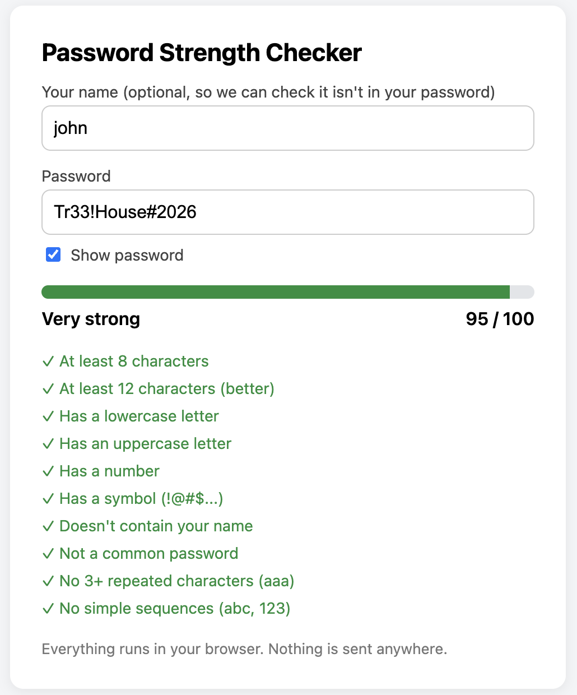

# Password Strength Checker

A browser-based tool that scores a password out of 100 and shows which
rules it passes or fails, in real time.

**Live demo:**(https://us9785.github.io/password-strength-checker/)

## Features
- Live score out of 100 with a Weak / Medium / Strong / Very strong label
- Checklist of rules that tick off as you type
- Optional name field, so the tool can warn if your name is in the password
- Show/hide password toggle
- Runs fully in the browser. No password is stored or sent anywhere.

## How the score works
| Part | Points | Details |
|------|--------|---------|
| Length | up to 40 | Full marks at 16+ characters |
| Character variety | up to 40 | 10 each for lowercase, uppercase, number, symbol |
| Uniqueness | up to 20 | Ratio of different characters to total length |

**Penalties:**
- Contains your name: -20
- Repeated characters (`aaa`): -10
- Simple sequences (`abc`, `123`): -10
- Under 8 characters: score capped at 30
- Matches a common password: score capped at 5

## Limitations
This is a rule-based checker. It can't detect everything attackers try,
such as leaked passwords, keyboard patterns (`qwerty`), or predictable
substitutions (`P@ssw0rd`). A password that passes every rule can still
be weak.

## Roadmap
- [ ] Load the top 10,000 common passwords list
- [ ] Estimate crack time from entropy
- [ ] Check breaches via the Have I Been Pwned API (k-anonymity)

## Tech
HTML, CSS, vanilla JavaScript. Single file, no dependencies.
